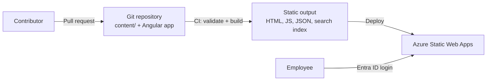

# Cegeka AI Hub — Project Blueprint

## 1. Project overview

**Project:** Cegeka AI Hub  
**Purpose:** A central internal platform where Cegeka employees can discover AI tools, learn practical skills, explore relevant use cases, experiment with prompts and workflows, and share knowledge.

**Vision:** **Discover. Learn. Experiment. Share.**

The AI Hub should make AI approachable and useful in everyday work. It should help colleagues understand what is available, identify where AI can help, and apply it responsibly.

### Initial decisions and constraints

| Area | Decision |
|---|---|
| Audience | All Cegeka employees |
| Product approach | Start as an experiment, then grow incrementally if the pilot shows value |
| Product ambition | Polished, production-quality internal web application |
| Content management | **Git only.** All content is Markdown in the repository and changes through pull requests. There is no admin UI, now or later |
| Architecture | **Static site.** Angular builds the Markdown into a static website. No backend API and no database |
| Feedback | Employees contact an **AI Champion** (for example via Teams). The app does not store feedback |
| Hosting | Azure Static Web Apps on existing Cegeka Azure infrastructure, subject to approval |
| Authentication | Microsoft Entra ID / company account, enforced by the hosting platform |
| Initial content owners | AI Coach team |
| Initial language | English; design for future multilingual support |
| Branding | Cegeka branding with a dedicated AI Hub identity |
| Builder's role | Combination of educator, builder, and connector |

Infrastructure choices and technology standards must be confirmed against Cegeka's approved architecture and platform guidelines before implementation.

### 1.1 Why a static site without backend or database

All content changes through Git, and the app does not store user data. A backend and database would therefore only copy what is already in the repository.

| Concern | How a static site handles it |
|---|---|
| Content editing, review, versioning, audit | Pull requests, code review, and Git history |
| Draft vs published | Front-matter `status`; the build only includes `Published` content |
| Search | Search index generated at build time, searched in the browser |
| Access control | Entra ID login enforced by the hosting platform for every file |
| Feedback | Handled by people (AI Champions), not stored in the app |
| Cost and maintenance | No server, database, migrations, or API to patch and monitor |

**When to add a backend later:** only when a feature needs to write or compute data on the server, for example favourites, in-app feedback, or AI-powered features (semantic search, prompt assistant). Azure Static Web Apps can link a backend (Azure Functions or an ASP.NET Core App Service) without changing the frontend architecture.

### 1.2 Frontend framework decision

Angular is retained. React was considered.

| Factor | Angular | React |
|---|---|---|
| Builder/maintainer skills | Strongest skill of the builder and maintainer | Would need ramp-up |
| Built-in capabilities | Router, HTTP, DI, i18n, prerendering included | Requires choosing libraries (router, data fetching, i18n) or a meta-framework |
| Static content sites | Supported through build-time prerendering | Strong ecosystem (for example Next.js, Astro) |

**Rationale:** For a solo builder who is strongest in Angular, switching frameworks adds risk without a clear benefit. Revisit only if the Cegeka design system is available exclusively as React components or a React-based team takes over maintenance.

### 1.3 Goals and success metrics

Define measurable goals before the pilot so that the experiment can be evaluated objectively. Because the app does not store user data, measurement relies on surveys, AI Champion input, and (optionally) approved, privacy-friendly page analytics.

| Goal | Example metric | Example pilot target |
|---|---|---|
| Qualitative value | Pilot survey: "The AI Hub helps me in my work" | Average ≥ 4/5 |
| Employees find what they need | Pilot survey: "I found what I was looking for" | ≥ 70% agree |
| Content stays current | Items past review date | 0 at pilot end |
| Content grows | New or updated items per month | Agreed with AI Coach team |
| Usage (optional, if analytics approved) | Unique visitors and returning visitors | Agreed with AI Coach team |

Targets are placeholders to be agreed with the AI Coach team.

### 1.4 Target users

| Persona | Need |
|---|---|
| AI beginner (any department) | Understand what is allowed and get started with simple, safe examples |
| Practitioner (business or technical) | Find prompts and use cases for their role, quickly |
| Developer / technical specialist | Find developer tools, advanced prompts, and workflows |
| Manager / team lead | Identify opportunities and approved tools for their team |
| AI Coach / content contributor | Add and update content through Git with little effort |
| AI Champion | Be findable, answer questions, and pass on feedback |

---

## 2. Product principles

1. **Practical first:** Focus on concrete tasks and outcomes rather than AI theory alone.
2. **Accessible to everyone:** Provide useful entry points for beginners and experienced technical users.
3. **Responsible by design:** Make approved usage, data handling, and security guidance easy to find.
4. **Content-driven:** Make it straightforward for the AI Coach team to keep information current through Git.
5. **Incremental:** Deliver a useful MVP before adding advanced AI features.
6. **Measurable:** Learn which content is useful through proportionate, privacy-friendly means.
7. **Simple:** Do not add servers, databases, or services until a feature needs them.
8. **Extensible:** Keep the structure ready for more languages, content types, and capabilities.

## 3. Core pillars

### Discover
Help employees discover AI tools, capabilities, and practical opportunities.

### Learn
Offer short guides, tutorials, learning paths, and responsible-use guidance.

### Experiment
Provide reusable prompts, examples, and workflows employees can adapt.

### Share
Connect employees with AI Champions, and collect ideas, success stories, and feedback through them. More community features can follow after the MVP.

---

## 4. MVP scope

The MVP is a searchable, static content website for employees. Content is managed in Git (section 4.2).

### 4.1 Employee-facing features

#### Home dashboard
- Clear introduction to the AI Hub.
- Featured content (front-matter flag).
- Recently published or updated content.
- Shortcuts to tools, prompts, use cases, and guides.
- Search entry point.

#### AI Tools catalogue
- Browse tools available or relevant within Cegeka.
- Tool detail page with description, provider, access method, website link, and availability status.
- Clearly distinguish company-approved, restricted, experimental, and external tools.
- Show how to get access (license request, self-service, not available), cost/licensing model where relevant, and which data classifications may be used with the tool.
- Show a contact or owner for questions about the tool.
- Show the date the availability status was last verified.
- Avoid implying that a tool is approved unless that status has been verified.

#### Prompt Library
- Browse and search reusable prompts.
- Filter by category, role, difficulty, or tags.
- Prompt detail page with purpose, instructions, example input/output where available.
- Show which tool(s) the prompt is intended for.
- Mark placeholders the user must fill in (for example `{{code}}`, `{{audience}}`) so they are easy to spot.
- Copy prompt action (handled in the browser).
- Include both technical and non-technical prompts.

#### Use Cases catalogue
- Practical examples of how AI can help with work.
- Organize by department, role, task, or category.
- Explain the problem, suggested approach, expected benefit, and relevant tools.
- Treat estimated time savings as indicative unless measured.

#### Guides and Tutorials
- Short, actionable guides.
- Beginner-to-advanced difficulty.
- Estimated reading or completion time.

#### AI Guidelines
- Responsible AI guidance.
- Security and privacy reminders.
- Data classification and approved-tool guidance, aligned with official company policies.
- Links to authoritative internal policies where available.
- Guideline list and guideline detail pages.
- Clearly state that the official policy prevails if it differs from AI Hub content.

#### Related content
- Detail pages link to related items (for example a use case links to its tools, prompts, and guides).

#### Search
- Search across published tools, prompts, use cases, guides, and guidelines.
- Filter by content type, category, difficulty, and language.
- Implemented in the browser with a search index generated at build time (for example MiniSearch, Lunr, or Fuse.js). Suitable for hundreds of items.
- The index contains published content only.

#### AI Champions and feedback
- AI Champions page: name, department/region, topics they can help with, and a "Message on Teams" link.
- Every content page has a "Questions or feedback? Contact an AI Champion" link, plus a "Report outdated content" link that contacts the content owner or an AI Champion.
- AI Champions pass feedback to the AI Coach team, who update content through Git.
- The app does not store feedback or comments.

#### About and help
- Who runs the AI Hub, how to suggest content, and where to ask questions (for example a Teams channel).

### 4.2 Content management (Git only)

- Content lives as Markdown files with YAML front matter in a `content/` folder in the repository.
- One file per content item and language (for example `content/prompts/generate-unit-tests.en.md`).
- Front matter holds metadata: type, slug, status, categories, tags, owner, review date, featured flag, and type-specific fields (section 8).
- Reference data (categories, AI Champions) lives in YAML files, for example `content/_data/categories.yml` and `content/_data/champions.yml`.
- Images live next to the content or in `content/_media/`, with size and format limits checked in CI.
- Every change goes through a pull request. The AI Coach team reviews and approves (enforced with branch protection and `CODEOWNERS`).
- CI validates content on every pull request (section 11). Merging to the main branch publishes automatically.
- Git history is the audit trail.
- Contributors without Git experience can edit Markdown in the repository's web editor, which creates the pull request for them.

Example:

```markdown
---
type: Prompt
slug: generate-unit-tests
status: Published
categories: [development]
tags: [testing, csharp]
owner: ai-coach-team
reviewAt: 2027-05-01
featured: true
difficulty: Beginner
intendedTools: [github-copilot]
---
# Generate unit tests

Write unit tests for the following code: {{code}}
```

### 4.3 Explicitly out of scope

Do not build these before the core content site is working:

- Backend API or database.
- Administration UI (content is managed in Git only).
- In-app feedback, comments, or ratings.
- AI chatbot or conversational assistant.
- AI-powered recommendations.
- Agent marketplace.
- Skill tracking or employee assessments.
- Full learning-management system.
- Automated translation.
- LLM integration or prompt execution against company data.
- Advanced analytics or adoption scoring.

### 4.4 Potential later features

Features marked * need a backend (see 1.1).

- Events, workshops, and office hours (can be static content).
- AI news and announcements (can be static content).
- Success stories and show-and-tell posts (can be static content).
- Employee idea submission (for example a Microsoft Form link, or * in-app).
- Favorites and saved content (* or browser local storage only).
- AI-powered semantic search *.
- AI Opportunity Finder to help identify automation opportunities *.
- Prompt improvement assistant *.
- Workflow generator *.
- Adoption and value dashboard.
- Microsoft Teams tab that embeds the AI Hub.

---

## 5. Suggested initial content

Populate the site before launch so that it feels useful immediately.

| Content type | Initial target |
|---|---:|
| AI tools | 8–10 |
| Prompts | 20–30 |
| Use cases | 10 |
| Guides | 5–8 |
| Guidelines | 3–5 |
| AI Champions | All current champions who agree to be listed |

Possible first guides:

1. Introduction to Generative AI.
2. Writing effective prompts.
3. Responsible AI at work.
4. Getting started with Microsoft Copilot.
5. Understanding AI hallucinations.
6. Everyday productivity with AI.

The Prompt Library should contain examples for technical and non-technical roles.

### Content governance

- The AI Coach team owns content quality and approves pull requests.
- Tool availability status (`CompanyApproved`, `Restricted`, …) may only be set based on a confirmed decision from the responsible team (for example IT, security, or procurement), with the source recorded in front matter.
- Use a short editorial style guide (`content/STYLE-GUIDE.md`): tone, length, structure of guides and prompts, and how to mark indicative claims (such as time savings).
- Each content item has a named owner; when an owner leaves, ownership moves to the AI Coach team.
- AI Champions are listed only with their consent and can ask to be removed at any time.
- Content is visible to every signed-in employee. Do not put confidential, client, or personal information in content.

---

## 6. Recommended architecture

A static Angular website, generated from Markdown at build time and served behind Entra ID login.



### 6.1 Components

- **Frontend:** Angular application.
- **Content pipeline:** Node.js build script that reads `content/`, validates front matter against a schema, converts Markdown to sanitized HTML, and writes JSON files plus a search index into the Angular build.
- **Rendering:** Either a single-page app that loads the generated JSON, or Angular build-time prerendering (`outputMode: 'static'`) of all content routes for faster first load. Start with whichever is simpler; prerendering can be added later.
- **Search:** Client-side search index generated at build time.
- **Hosting:** Azure Static Web Apps (Standard plan, needed to restrict login to the Cegeka tenant; verify current plan features). Alternative: Azure App Service with built-in authentication (Easy Auth) serving the static files.
- **Authentication:** Static Web Apps built-in authentication with a custom Microsoft Entra ID provider registered in the Cegeka tenant.
- **Monitoring (optional):** Application Insights browser SDK for errors and, if approved, page views.
- **Infrastructure as code:** Bicep or Terraform, depending on the Cegeka standard.
- **Environments:** Production plus pull-request preview environments (Static Web Apps creates these per pull request where supported).
- **CI/CD:** Existing Cegeka pipeline standards (GitHub Actions or Azure DevOps Pipelines).

All Azure services and deployment patterns are recommendations pending architecture and security approval. Get a rough monthly cost estimate before provisioning.

### 6.2 Architectural principles

- Content is data in `content/`, never hardcoded into Angular components.
- The build is the gatekeeper: invalid content fails CI and is never deployed.
- Only `Published` content is included in the build output. Every file in the output can be downloaded by any signed-in employee, so drafts and archived items must never be in it.
- Access control is enforced by the hosting platform for every request, including JSON and asset files. Angular code does not decide who can see content.
- Design the content model and UI text for multiple languages from the start.
- Do not add a backend until a feature needs one (see 1.1).

### 6.3 Repository structure

```text
/
├── content/
│   ├── _data/
│   │   ├── categories.yml
│   │   └── champions.yml
│   ├── _media/
│   ├── tools/
│   ├── prompts/
│   ├── use-cases/
│   ├── guides/
│   ├── guidelines/
│   └── STYLE-GUIDE.md
├── tools/
│   └── content-build/        # validate + Markdown → JSON + search index
│       ├── schema/
│       └── src/
├── src/                      # Angular application
├── public/
│   └── staticwebapp.config.json
├── infra/                    # Bicep or Terraform
├── docs/
│   └── adr/
└── .github/ or pipelines/    # CI/CD
```

---

## 7. Authentication and access

- Every route and file requires an authenticated Cegeka account; this is configured in `staticwebapp.config.json`, not in Angular.
- Use a single-tenant Entra app registration for the Cegeka tenant. Decide whether guest accounts are allowed.
- Disable other identity providers (for example GitHub) so that only Entra ID sign-in is possible.
- Unauthenticated requests redirect to the Entra login.
- Angular can call `/.auth/me` to show the user's name; it does not need MSAL.
- There are no application roles: all signed-in employees see the same published content. Contributor rights are managed in the Git repository, not in the app.
- Store the app registration secret in the hosting platform's settings (or Key Vault reference). Track its expiry; prefer a certificate or federated credential where supported.

Example (placeholders; confirm against current Static Web Apps documentation):

```json
{
  "auth": {
    "identityProviders": {
      "azureActiveDirectory": {
        "registration": {
          "openIdIssuer": "https://login.microsoftonline.com/<TENANT_ID>/v2.0",
          "clientIdSettingName": "AAD_CLIENT_ID",
          "clientSecretSettingName": "AAD_CLIENT_SECRET"
        }
      }
    }
  },
  "routes": [
    { "route": "/.auth/login/github", "statusCode": 404 },
    { "route": "/*", "allowedRoles": ["authenticated"] }
  ],
  "responseOverrides": {
    "401": { "redirect": "/.auth/login/aad", "statusCode": 302 }
  },
  "navigationFallback": { "rewrite": "/index.html" }
}
```

---

## 8. Content model

Each content file has front matter validated against a JSON Schema (for example with Zod or Ajv) in the content build.

### 8.1 Common fields (all content types)

| Field | Required | Notes |
|---|---|---|
| `type` | Yes | `Tool`, `Prompt`, `UseCase`, `Guide`, `Guideline` |
| `slug` | Yes | Unique per type; URL-friendly; same slug across languages |
| `status` | Yes | `Draft`, `Published`, `Archived`; only `Published` is built |
| `title` | Yes | Or taken from the first `#` heading |
| `summary` | Yes | Short text for cards and search |
| `categories` | Yes | Must exist in `categories.yml` |
| `tags` | No | Language-neutral keywords |
| `owner` | Yes | Person or team; display name only, no personal IDs needed |
| `reviewAt` | Yes | Date when the content must be checked again |
| `featured` | No | Shown on the home page |
| `publishedAt` | No | Defaults to first publish date from Git history |
| `related` | No | List of `type/slug` references, validated to exist |
| `redirectFrom` | No | Old slugs, so shared links keep working |

The language comes from the file name (`*.en.md`, `*.nl.md`). Every published item must have an English file. When a requested language is missing, show English and indicate that.

### 8.2 Type-specific fields

**Tool**
- `provider`, `websiteUrl`.
- `accessType` — `Web`, `Desktop`, `IDE`, `Integration`.
- `availability` — `CompanyApproved`, `Restricted`, `Experimental`, `External`.
- `availabilityVerifiedAt` and `availabilitySource` — required when `availability` is `CompanyApproved` or `Restricted`.
- `licenseModel` — `Included`, `PerUserLicense`, `Free`, `Unknown`.
- `maxDataClassification` — using the company classification scheme.
- Access instructions in the Markdown body.

**Prompt**
- `difficulty` — `Beginner`, `Intermediate`, `Advanced`.
- `intendedRoles`, `intendedTools` (tool slugs).
- The prompt text is the first fenced code block or a dedicated section; optional example input/output sections.

**UseCase**
- `departments`, `difficulty`, `tools` (tool slugs).
- `estimatedTimeSaved` — optional and clearly indicative unless validated.

**Guide**
- `difficulty`, `estimatedMinutes`.

**Guideline**
- `policyLinks` — links to authoritative internal policies.

### 8.3 Reference data

- `categories.yml`: `slug`, translated `name` per language, `active`.
- `champions.yml`: `name`, `department`, `region`, `topics`, `teamsLink`. Listed with consent only.

---

## 9. Build output

The content build writes static JSON that Angular reads. There is no API.

| File | Contents |
|---|---|
| `/data/{lang}/index.json` | Card data for all published items (type, slug, title, summary, categories, tags, difficulty, featured, dates) |
| `/data/{lang}/{type}/{slug}.json` | Full item including sanitized HTML body and type-specific fields |
| `/data/{lang}/search-index.json` | Prebuilt search index |
| `/data/categories.json`, `/data/champions.json` | Reference data |
| `staticwebapp.config.json` | Includes redirects generated from `redirectFrom` |

For a few hundred items, loading `index.json` once and filtering in the browser is fast enough. Split the files only if size becomes a problem.

---

## 10. Angular application

### 10.1 Routes

```text
/
├── tools
│   └── :slug
├── prompts
│   └── :slug
├── use-cases
│   └── :slug
├── guides
│   └── :slug
├── guidelines
│   └── :slug
├── champions
├── search
└── about
```

Add a not-found page. Access is enforced by the hosting platform (section 7), so no route guards are needed.

### 10.2 Suggested folder structure

```text
src/app/
├── core/
│   ├── content/          # loads generated JSON, language fallback
│   ├── search/           # client-side search service
│   ├── user/             # reads /.auth/me
│   └── layout/
│       ├── app-shell/
│       ├── header/
│       └── footer/
├── features/
│   ├── home/
│   ├── tools/
│   ├── prompts/
│   ├── use-cases/
│   ├── guides/
│   ├── guidelines/
│   ├── champions/
│   ├── search/
│   └── about/
├── shared/
│   ├── components/
│   │   ├── content-card/
│   │   ├── search-bar/
│   │   ├── category-filter/
│   │   ├── difficulty-badge/
│   │   ├── availability-badge/
│   │   ├── copy-button/
│   │   ├── contact-champion/
│   │   └── empty-state/
│   └── models/           # types shared with the content build
├── app.routes.ts
└── app.config.ts
```

### 10.3 Frontend implementation guidance

- Use the current supported Angular version and modern defaults: standalone components, signals, built-in control flow, lazy-loaded feature routes, zoneless change detection where stable.
- Share TypeScript types between the content build and the Angular app so they cannot drift.
- Render body HTML that was sanitized at build time; Angular's built-in sanitizer remains active when binding it.
- Keep filters and search terms in the URL query string so results can be shared and bookmarked.
- Do not introduce NgRx or other state libraries; there is little state.
- Ensure responsive layouts and keyboard accessibility.
- Use the approved Cegeka design system where available; otherwise Angular CDK/Angular Material with a theme aligned with Cegeka branding.
- Prepare UI text for translation (Angular i18n or a runtime translation library).

---

## 11. Content lifecycle and publishing

```text
Draft → Published → Archived
```

- Lifecycle is the front-matter `status` field, changed through pull requests.
- Merging to the main branch builds and deploys the site.
- Pull-request preview environments let reviewers see changes before merging.

### CI checks on every pull request

- Front matter matches the schema for its type.
- Slugs are unique; `related`, `intendedTools`, `tools`, and categories refer to existing items.
- Every published item has an English file.
- `CompanyApproved`/`Restricted` tools have a verification date and source.
- Markdown contains no raw HTML or scripts; links are valid (internal links checked, external links optionally).
- Images are within size and format limits.
- No secrets or obvious personal data (for example a secret scanner).
- Build output contains no `Draft` or `Archived` content.

### Review reminders

- A scheduled pipeline (for example weekly) lists content past or near its `reviewAt` date and creates or updates an issue/work item for the owner or AI Coach team.
- The build can warn (not fail) on overdue content, so urgent fixes are not blocked.

---

## 12. Security and non-functional requirements

### Security

- Entra ID authentication enforced by the hosting platform for every route and file.
- Single-tenant sign-in; other identity providers disabled.
- HTTPS everywhere.
- Only published content in the build output.
- Markdown converted with raw HTML disabled and sanitized at build time (for example remark/rehype with `rehype-sanitize`).
- Security headers via `staticwebapp.config.json` (`globalHeaders`): Content Security Policy, `X-Content-Type-Options`, `Referrer-Policy`, HSTS.
- Branch protection, required reviews, and `CODEOWNERS` on the main branch.
- Dependency updates (Dependabot/Renovate or the company equivalent) and vulnerability scanning in CI.
- No secrets in the repository.
- Follow company data-classification and approved-tool policies.

### Privacy

- The app stores no personal data. Feedback goes to AI Champions through existing company channels.
- Hosting and sign-in logs are handled by the platform; confirm retention with the platform team.
- AI Champions are listed with consent only.
- Optional page analytics require approval under company policy; prefer aggregated data.

### Reliability and maintainability

- No server-side runtime to patch or scale; the hosting platform serves static files.
- Deployments are reproducible from Git; roll back by redeploying an earlier commit.
- Document local development (`npm start` with local content) and the contribution process (`CONTRIBUTING.md`).
- Define a support owner after the experiment: who merges content, updates dependencies, and renews the app registration secret.
- Indicative performance target: pages interactive within 2 seconds on a typical office connection.

### Accessibility and usability

- Target WCAG 2.2 level AA.
- Responsive desktop and mobile layouts.
- Keyboard navigation and visible focus states.
- Semantic headings and controls.
- Sufficient contrast.
- Clear loading, empty, and error states.

---

## 13. Testing strategy

### Content build
- Unit tests for schema validation, Markdown conversion, sanitization, and search-index generation.
- Tests with invalid fixtures: missing fields, duplicate slugs, unknown references, missing English file, raw HTML/scripts.

### Frontend
- Component and service unit tests.
- End-to-end tests for important flows (for example Playwright): browse, filter, search, view detail, copy prompt, contact a champion.
- Accessibility checks in end-to-end tests (for example axe).

### Deployment smoke tests
- An unauthenticated request to a page and to a `/data/...` file is redirected to login.
- Signed-in users can load the home page.

### Critical acceptance/security tests

1. Unauthenticated users cannot load any page, JSON, or media file.
2. Only Cegeka-tenant accounts can sign in.
3. Draft and archived content never appear in the build output, listings, or search.
4. The build fails if a published item lacks an English file.
5. The build fails on invalid front matter or broken internal references.
6. Markdown cannot inject scripts.
7. Old slugs listed in `redirectFrom` redirect to the current page.

---

## 14. Development roadmap

The estimate assumes one developer and reasonably timely access to approved infrastructure. It excludes approval delays and the time needed to write the initial content. Add a contingency of about 20–30%; first-time setup of Entra and hosting often takes longer than expected.

| Epic | Scope | Estimate |
|---|---|---:|
| 1. Foundation | Angular setup, repository structure, CI/CD, Static Web Apps, Entra login, infrastructure as code | 3–4 days |
| 2. Content pipeline | Schema, validation, Markdown → sanitized HTML/JSON, search index, redirects, CI checks | 3–4 days |
| 3. Application shell | Layout, responsive design, theme, UI i18n setup, reusable cards and badges | 2–3 days |
| 4. Employee experience | Home, catalogues, details, related content, search/filter, champions, about | 4–6 days |
| 5. Pilot readiness | Tests, accessibility, security headers, review-reminder pipeline, contribution docs, pilot | 3–4 days |
| **Total** |  | **15–21 developer days** |

### Suggested milestones

**Milestone 0 — Experiment (walking skeleton)**
- Repository structure and CI/CD.
- Static Web Apps with Entra login restricted to the Cegeka tenant.
- Content build for prompts and tools only.
- Home page, prompts list/detail with copy action, tools list/detail.
- A handful of real content items.
- Shown to a few colleagues and AI Champions.
- Decision point: continue to the MVP, adjust, or stop.

**Milestone 1 — Content site**
- All content types, related content, and redirects.
- Search and filters.
- AI Champions page and contact links.

**Milestone 2 — Pilot readiness**
- Security, accessibility, and privacy checks.
- Review-reminder pipeline and contribution guide.
- Initial content population through pull requests.
- Pilot with 10–20 employees across different departments, measured against section 1.3.

Start with Milestone 0. It gives a visible, deployed result within a few days and tests the riskiest parts first: hosting, login, and the content pipeline.

---

## 15. Definition of Done for the MVP

The MVP is ready for pilot when:

- Employees can sign in with their Cegeka company account, and nobody else can.
- Published tools, prompts, use cases, guides, and guidelines can be browsed, with detail pages.
- Search and filtering work across published content.
- Prompts can be copied easily.
- Employees can find and contact an AI Champion from every content page.
- Content can be added and updated through validated pull requests, with preview before merge.
- Content has an owner and review date, and overdue content is reported automatically.
- English is supported and the structure is ready for additional languages.
- Critical automated tests pass.
- Security, privacy, and accessibility reviews have been completed to the agreed level.
- Initial content is populated and reviewed.
- Success metrics (section 1.3) are agreed and can be measured.
- A pilot group has tested the site and feedback has been addressed.

---

## 16. Risks, assumptions, and open questions

### Risks

| Risk | Mitigation |
|---|---|
| Single builder (bus factor of one) | Keep documentation, ADRs, and setup scripts current; keep the stack mainstream |
| Content goes stale after launch | Owners, review dates, and automated review reminders |
| Contributors find Git difficult | Web editor, templates per content type, short contribution guide, AI Coach team helps |
| Showing a tool as approved when it is not | CI requires a verification date and source |
| Feedback gets lost because it is not stored | Clear process for AI Champions to pass feedback to the AI Coach team |
| Little usage data to judge the experiment | Pilot survey and champion feedback; optional approved analytics |
| Approvals (architecture, security, identity) take longer than development | Request them early, in parallel with Milestone 0 |
| Overlap with existing intranet/SharePoint content | Link to authoritative sources instead of copying them |

### Open questions

1. Is Azure Static Web Apps (Standard) approved, or should App Service with Easy Auth be used?
2. GitHub or Azure DevOps for the repository and pipelines?
3. Are guest/external accounts allowed?
4. Is there a Cegeka design system or Angular component library to use?
5. Which data-classification scheme should tool pages reference?
6. Who confirms tool availability status, and where is that recorded?
7. Who are the AI Champions, and have they agreed to be listed?
8. Is optional page analytics allowed, and under which conditions?
9. Which languages come after English, and when?
10. Who owns support and maintenance after the experiment?

Record decisions as short Architecture Decision Records (ADRs) in `docs/adr/`.

---

## 17. Guidance for an AI coding assistant

When using this document as context in an IDE-based AI assistant, follow these instructions:

1. Treat this document as the product and architecture baseline, not as permission to make unapproved infrastructure or identity decisions.
2. Inspect the existing repository, package versions, and conventions before generating files.
3. Prefer existing project conventions and approved dependencies over introducing new frameworks or packages.
4. Do not generate the entire application in one step. Implement one milestone or vertical slice at a time.
5. Before making large structural changes, explain the proposed changes and identify assumptions.
6. Do not add a backend, database, admin UI, or in-app feedback storage unless the scope is explicitly changed.
7. Keep the content build and Angular types aligned; share the types.
8. Never let `Draft` or `Archived` content reach the build output.
9. Add tests alongside features, especially for content validation and sanitization.
10. Do not invent Entra tenant IDs, client IDs, secrets, URLs, subscription details, or company-specific configuration. Use clearly named placeholders and document what an administrator must provide.
11. Do not claim that a tool, provider, or AI service is company-approved unless that status is explicitly confirmed.
12. Keep the MVP free of LLM integrations unless the scope is explicitly changed.
13. Maintain a concise implementation plan and update it as milestones are completed.
14. Ask focused questions only when a decision blocks safe or correct implementation. Otherwise, make conservative, clearly documented assumptions.

### Recommended first task for the IDE assistant

If the repository is empty (greenfield), propose the repository layout, tooling versions, and the Milestone 0 plan, and wait for confirmation before scaffolding.

Otherwise, inspect the repository and report:

- Existing structure and framework versions.
- Existing CI/CD and hosting configuration.
- Existing UI component library and design system.
- Any conflicts between the repository and this blueprint.

Do not modify files during this initial inspection. After reporting findings, propose the smallest first implementation milestone.
